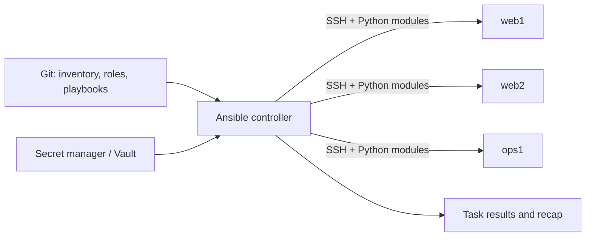
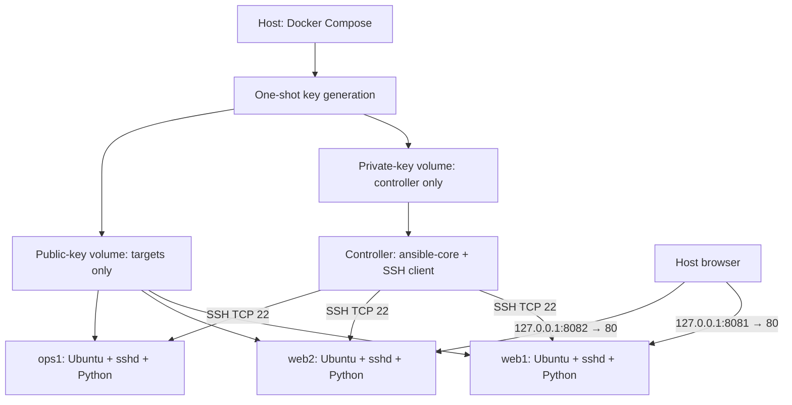

# 01 — Fundamentals and architecture

## Learning outcomes

Explain agentless configuration management, read a playbook execution path, distinguish Terraform from Ansible, and reason about desired state.

## What Ansible does

Ansible describes operational intent: install a package, render a file, create a user, or deploy an application. The controller reads inventory and a playbook, resolves variables, connects to targets, transfers module code when needed, executes it, and collects structured results. Most POSIX modules need Python on the managed host. The `raw` module can bootstrap a machine without Python.

Agentless means no permanent Ansible agent is required on each target. It does not mean dependency-free: credentials, connectivity, Python, permissions, and any module-specific libraries must exist. Linux commonly uses SSH; Windows commonly uses WinRM or PSRP with different prerequisites.

## Logical architecture

1. The controller selects hosts from inventory and a play's `hosts` pattern.
2. It resolves variables and usually gathers facts.
3. Each task runs against the selected hosts, subject to strategy and batching.
4. A module inspects state and makes changes when necessary.
5. Tasks report `ok`, `changed`, `failed`, `unreachable`, or `skipped`.
6. Notified handlers run at handler flush points, normally at the end of a play.

The default linear strategy advances through tasks together across the current host batch. Concurrency is bounded by forks and connection constraints; a playbook is not a distributed transaction.

## Docker lab architecture

Compose service names provide DNS on the project network. SSH is not published on the host. Only the two demo HTTP ports are published, bound to loopback. The bridge network permits outbound package downloads; it is not an air-gapped security boundary.

The controller trusts SSH host public keys obtained through the local Docker daemon during bootstrap. It does not blindly trust network key scans. All nodes share an SSH identity for this lab; real fleets should use appropriate identity isolation and credential rotation.

## Desired state and idempotency

A task using `file: state=directory` should report no change once its directory exists with the requested properties. A task executing `shell: echo hello >> file` appends repeatedly and is not idempotent. Ansible does not automatically make arbitrary commands safe.

Convergence means the system reaches the declared state. It does not mean atomicity: if task four fails, the first three tasks may already have changed the machine.

## Tool boundaries

| Tool | Primary responsibility | Example |
|---|---|---|
| Terraform | Provision infrastructure and track resource identities in state | Networks, VM instances, load balancers |
| Ansible | Configure systems and orchestrate operations | Packages, config files, deployment checks |
| Docker | Package and isolate processes | Disposable target machines in this course |
| Kubernetes | Continuously reconcile cluster workloads | Replicas, scheduling, Services |
| Jenkins | Coordinate trusted automation workflows | Validate and approve an Ansible deployment |

Terraform and Ansible can complement each other: provision hosts, produce inventory, then configure them. Avoid having multiple tools independently own the same resource.

## Check your understanding

1. Why is an SSH connection failure different from a module failure?
2. Why does a second successful run not prove a playbook handles partial failure?
3. Why is a Docker container an inadequate test target for kernel upgrades?

Answers: transport failure prevents module execution; convergence and failure recovery are separate properties; containers share the host kernel and lack a complete independent OS lifecycle.
