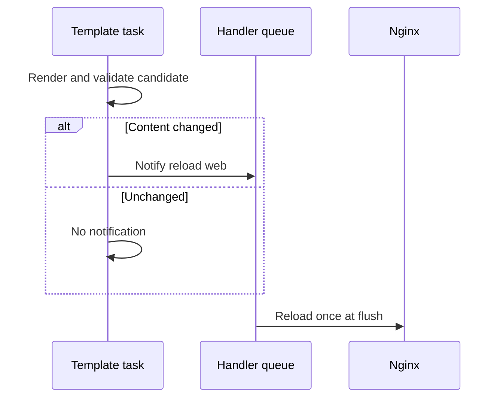

# 05 — Roles, handlers, and collections

## Why a role?

A role packages related tasks, defaults, templates, files, and handlers behind a small variable interface. A useful role does one cohesive job. Avoid a single role that configures every application and environment through dozens of flags.

```text
roles/web/
├── defaults/main.yml
├── tasks/main.yml
├── handlers/main.yml
└── templates/
    ├── nginx.conf.j2
    └── index.html.j2
```

The demo explicitly sets `roles_path=/work/roles` because its playbooks live in a sibling directory. Role defaults are designed to be overridden; role vars have higher precedence and are less suitable for configurable defaults.

## Handler lifecycle



Handlers are notified only by changed tasks and deduplicated per host within a flush cycle. They normally run at the end of a play, not immediately after the notifying task. Use `meta: flush_handlers` when subsequent health checks require the configuration to be active.

If a later task fails, previously notified handlers normally do not run on that host. `force_handlers` changes this behavior, but should not be enabled blindly: reloading partially prepared configuration may be unsafe.

The web playbook uses `serial: 1` and flushes handlers before verifying HTTP. This makes each host converge and pass health checks before advancing to the next batch. A web page content change does not require nginx reload; only nginx configuration changes notify its handler.

## Collections

Collections package modules, plugins, roles, and documentation under a namespace. Examples include `ansible.builtin`, `community.general`, and `amazon.aws`.

This lab uses only modules shipped with pinned `ansible-core`, so no Galaxy installation is required. When adding collections, create a `requirements.yml`, pin reviewed compatible versions, install them in CI, and account for Python SDK requirements. `ansible-core` and the larger `ansible` community package are not the same distribution.

## Exercise

1. Deploy the role twice; the second run should not reload nginx.
2. Change only `release_version`; the page should change without a reload.
3. Change `worker_connections` in web group variables; configuration should validate, change, and reload once per host.
4. Intentionally put an invalid nginx directive in a temporary copy of the template; explain how validation protects the installed configuration. Restore the template before continuing.
