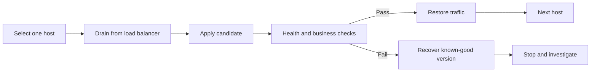

# 07 — Rolling changes, failures, and recovery

## Control the blast radius

- `--limit web1`: restrict the target set.
- `serial: 1`: process one host per batch in a play.
- `forks`: cap parallel task execution, not rollout batch policy.
- `any_errors_fatal: true`: stop the play across hosts after a fatal batch failure.
- `max_fail_percentage`: a different failure threshold mechanism; model its batch behavior before relying on it.

The web play uses serial batches, fatal failure propagation, configuration validation, and per-node HTTP checks. It is a rolling configuration example, not a complete zero-downtime deployment: there is no real load balancer draining traffic or preserving application sessions.

## End-to-end release sequence



For production, draining, connection handling, database compatibility, and rollback need explicit implementation. Merely setting `serial: 1` does not deliver those properties.

## Failure categories

| State | Meaning | First action |
|---|---|---|
| Unreachable | Cannot establish usable connection | Inspect DNS, SSH, host keys, user, network |
| Failed | A task/module ran and reported failure | Read module output and inspect state |
| Skipped | Conditional or mode prevented execution | Inspect `when`, tags, check mode |
| Changed unexpectedly | Desired state differs or reporting is wrong | Inspect diff and module semantics |

After a partial failure, rerunning a well-designed idempotent playbook is often appropriate. It is not always safe: schema migrations, external payments, and destructive operations need stronger coordination.

## Blocks and rescue

```yaml
- name: Attempt and recover a guarded operation
  block:
    - name: Require an explicit deployment gate
      ansible.builtin.assert:
        that: deployment_approved | default(false) | bool
  rescue:
    - name: Record that the attempt failed
      ansible.builtin.debug:
        msg: No change was approved; investigate before retrying
    - name: Keep the pipeline failed
      ansible.builtin.fail:
        msg: Deployment gate did not pass
```

`rescue` handles task failures, not all unreachable conditions or invalid syntax. A successful rescue can mark the original failure as rescued; deliberately fail afterward when CI must remain red. `always` is useful for cleanup but cannot guarantee cleanup after controller termination.

## Testing layers

1. Syntax check catches parsing and some structural problems.
2. Inventory inspection catches target-selection mistakes.
3. Check/diff on supported tasks estimates changes.
4. Disposable integration tests prove actual execution.
5. Second-run idempotency checks find accidental churn.
6. Failure injection and recovery tests explore partial state.
7. Staging validates real service managers, networking, and dependencies.

Run [Lab 05](../labs/05-recovery.md), then explain what it proves and what remains untested.
