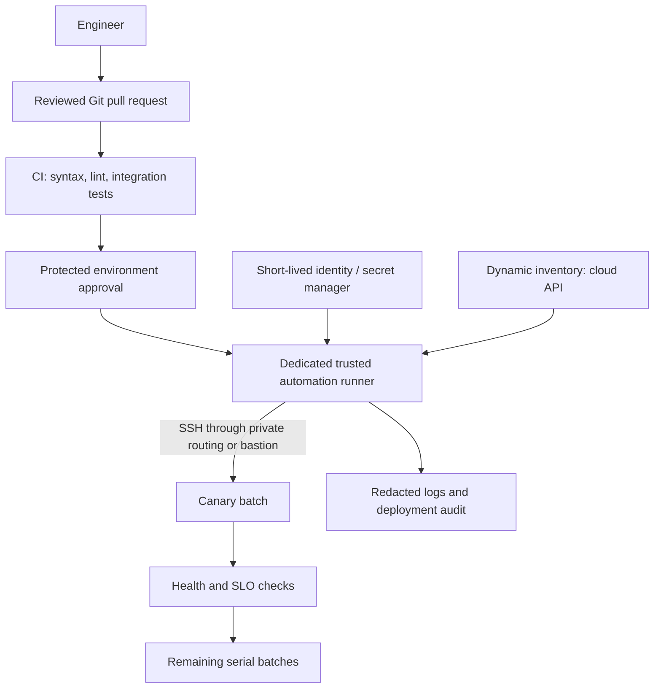

# 08 — Production architecture and CI/CD

## Reference architecture

Keep production runners separate from untrusted pull-request builds. Do not expose SSH credentials or Vault passwords to code from untrusted forks. Limit reachable networks and credential lifetime. Pin and review controller images, Python dependencies, collections, and role sources.

## Infrastructure handoff

Terraform can create networking, machines, identity, and load balancers. A reviewed dynamic inventory plugin or generated artifact can identify Ansible targets. Keep provisioning ownership and configuration ownership clear. Avoid exposing secrets through Terraform outputs just to make inventory generation easy.

Dynamic inventory still requires explicit plugin configuration, dependencies, filters, credentials, and caching policy. A wrong tag filter can target the wrong environment. Always show the selected hosts before approval.

## Pipeline stages

1. **Validate:** syntax, inventory schema, YAML style, ansible-lint using a pinned toolchain.
2. **Test:** ephemeral integration environment, first apply, health checks, second apply, idempotency.
3. **Review:** show target environment, commit SHA, artifact version, and non-secret diff.
4. **Approve:** authorized operator approves a protected environment.
5. **Deploy:** one deployment per environment, explicit limit, canary, health gates, bounded timeout.
6. **Audit:** retain redacted output and deployment metadata; revoke short-lived access.

This course does not install Jenkins plugins or add a production pipeline automatically. Translate the flow to your organization's trust model before automating real hosts.

## Availability and recovery

Configuration rollback differs from application rollback and database rollback. A restored config does not undo a destructive migration. Prefer backward-compatible schema changes, immutable application versions, validated configuration candidates, and tested recovery procedures.

For a VM fleet, replace the lab's process control with `systemd_service`, validate real service boot behavior, provision per-environment SSH trust, and separate inventory directories. Test load-balancer drain and health checks with realistic traffic.

## Design review questions

1. Who can change production inventory or inject extra vars?
2. What happens if the controller dies halfway through a batch?
3. How do credentials expire and get revoked?
4. How do you prevent two jobs changing the same environment?
5. Which changes are safe to rerun? Which need manual recovery?
6. How does a database migration remain compatible with old and new app versions?
7. What information must logs omit?
8. Which failure domains are not represented by this Docker lab?

Deliver your proposed design through [Lab 06](../labs/06-capstone.md).
